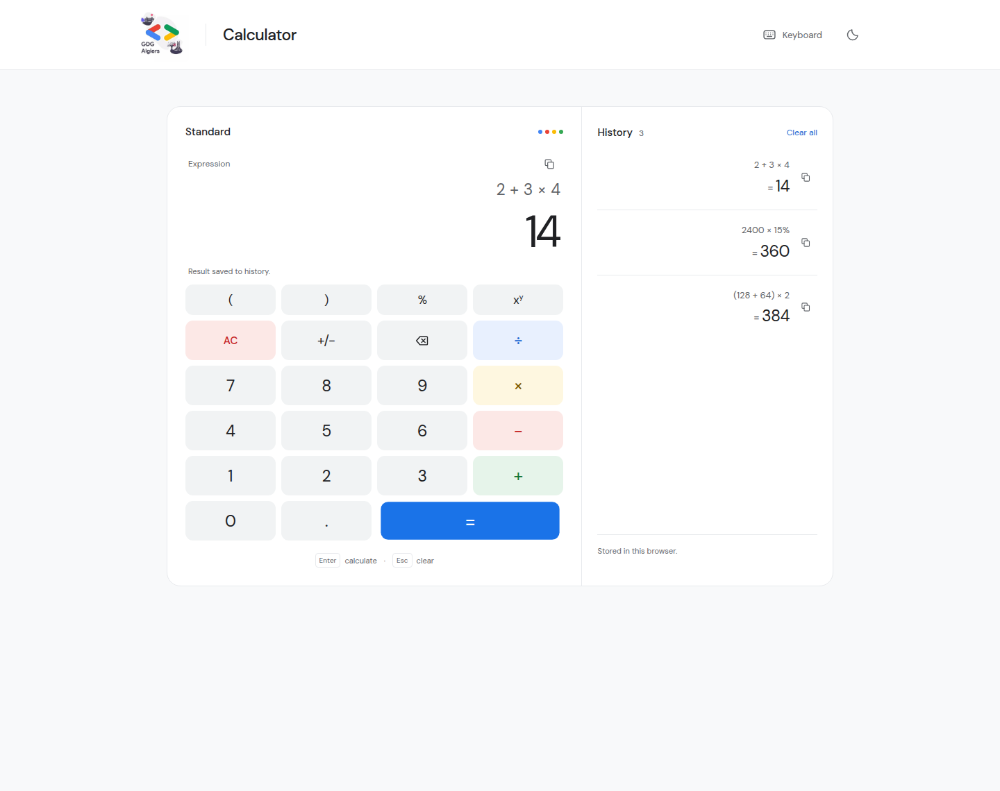
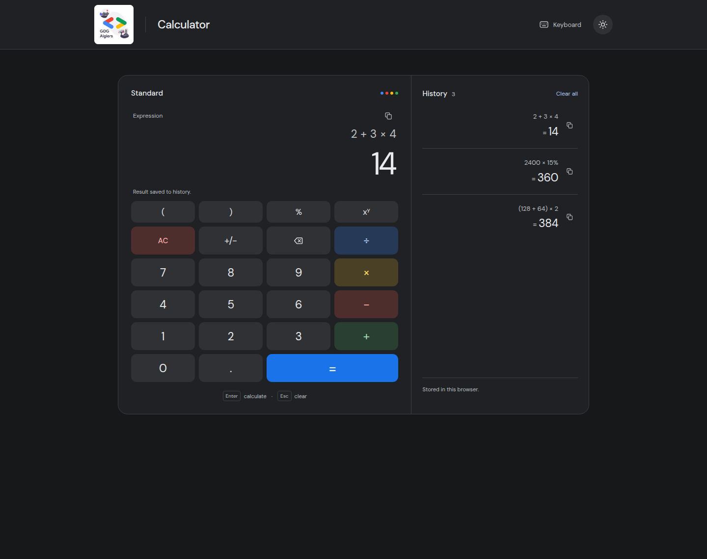
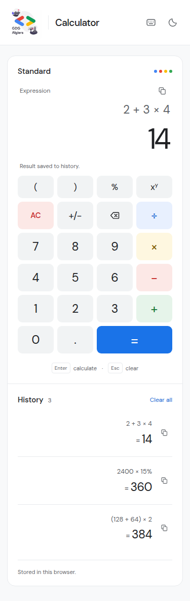

# GDG Algiers Calculator

A focused calculator built with **HTML, CSS, and vanilla JavaScript**. No framework, runtime library, bundler, or backend is needed. Node.js provides the local development server and test tooling only.

A compact interface uses the supplied GDG Algiers logo, neutral surfaces, and GDG's blue, red, yellow, and green for arithmetic operators. The calculator and calculation history sit together on desktop and stack on mobile.



<details>
<summary>Dark theme and mobile previews</summary>





</details>

## Run locally

Use Node.js 22 or newer. From this directory:

```sh
npm ci
npm run dev
```

Open [http://127.0.0.1:5173](http://127.0.0.1:5173). Set `PORT` to use a different local port.

## Features

- Responsive interface with light and dark themes.
- Mouse, touch, and keyboard input, including parentheses and backspace.
- Live result preview and a dedicated copy-result action.
- Addition, subtraction, multiplication, division, powers, and percentages with operator precedence.
- Calculation history that stores the last 30 results in the current browser.
- An in-app keyboard shortcut reference.

## Calculation rules

Expressions are evaluated by a dedicated parser; user input is never executed with `eval` or `Function`.

Parentheses are evaluated first. Powers take precedence over multiplication and division, which take precedence over addition and subtraction. Exponentiation associates to the right: `2^3^2` is `512`.

The `%` operator divides its operand by 100: `50%` is `0.5`, and `200 + 10%` is `200.1`. It does not infer a percentage of the preceding amount. Write `200 + 200 × 10%` to add ten percent of 200.

Arithmetic uses JavaScript numbers. Like most standard calculators, results have finite precision; extremely large calculations may be rejected or rounded for display.

Calculation history and theme preferences stay in this browser's local storage. The application does not send calculations to a server.

The interface includes visible keyboard focus, accessible control names, a native shortcut dialog, reduced-motion support, and announcements for submitted results. If device storage is blocked, calculations and history still work for the current visit. Fonts are bundled locally, with their SIL Open Font Licenses in `assets/fonts`, so the app makes no external requests.

## Keyboard shortcuts

| Key                   | Action                                                    |
| --------------------- | --------------------------------------------------------- |
| `0–9`, `.`            | Enter numbers                                             |
| `+`, `-`, `*`, `/`    | Arithmetic operators                                      |
| `(`, `)`              | Group expressions                                         |
| `^`, `%`              | Power and percentage                                      |
| `Enter`, `=`          | Calculate and save to history                             |
| `Backspace`, `Delete` | Edit at the caret                                         |
| `Escape`              | Clear the expression; close the shortcut dialog when open |
| `?`                   | Open the keyboard guide                                   |

After calculating, a digit starts a new expression and an operator continues the displayed result. Click the expression or move its caret to edit the previous calculation instead.

## Verify

```sh
npm test
npm run test:browser
npm run format:check
```

The 81 unit tests cover the expression engine. Twenty Playwright tests exercise the calculator in Chromium, including the GDG logo loading, keyboard interaction, touch at a 375px viewport, persistence, storage failures, errors, and editing after equals.

Browser tests automatically use `/usr/bin/google-chrome` when available. To use a different Chrome executable, set `CHROME_PATH`. If neither is available, install Playwright's Chromium first:

```sh
npx playwright install chromium
```

GitHub Actions runs both test suites for changes to this task. The browser test configuration starts the local server automatically.

Use `npm run format` to format the source. With the local server running, `npm run screenshots` refreshes the real UI screenshots in `docs/`.

## Project structure

```text
index.html               Semantic page and calculator controls
styles.css               Responsive interface and themes
gdg.jpeg                 Supplied GDG Algiers logo
assets/fonts/            Local fonts and license notices
docs/                    Desktop, dark, and mobile screenshots
js/                      Calculator logic and expression engine
scripts/serve.js          Local static server
test/engine.test.js      Expression engine tests
browser/calculator.spec.js  Browser interaction tests
```
